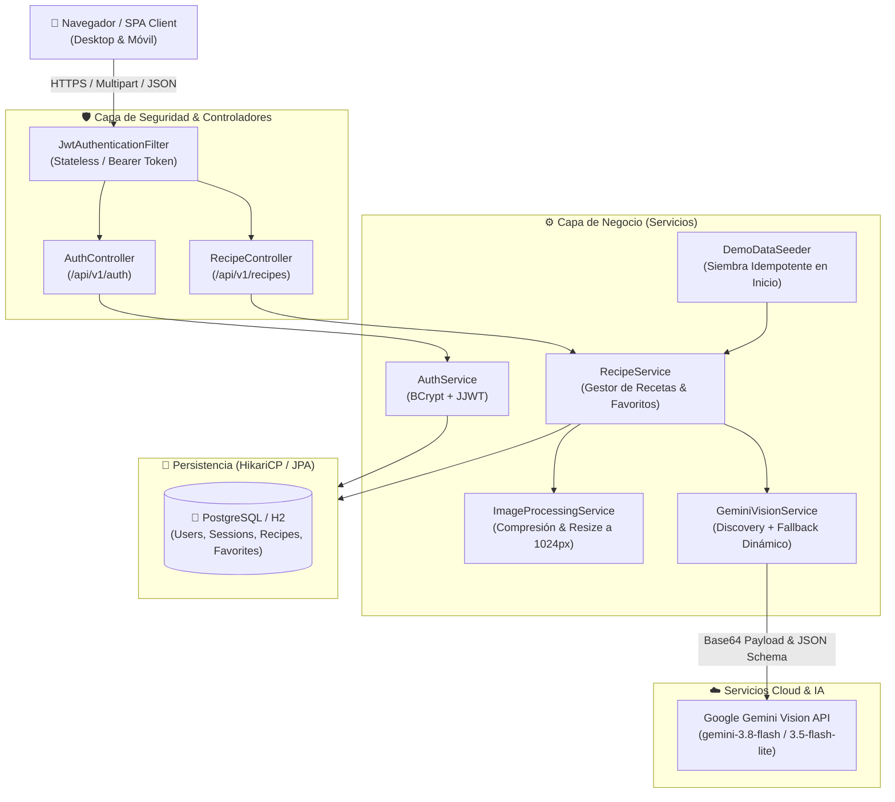

# 🍳 SmartChef AI API

[](https://smartchef-ai-api.onrender.com/)
[](https://smartchef-ai-api.onrender.com/swagger-ui.html)
[](https://openjdk.org/)
[](https://spring.io/projects/spring-boot)
[](https://spring.io/projects/spring-security)
[-success?style=for-the-badge&logo=junit5)](https://github.com/MrOdar/smartchef-ai-api)
[](https://www.postgresql.org/)

> **API REST empresarial y Single Page Application (SPA)** de arquitectura hexagonal construida en **Spring Boot 3.3.4 (Java 21 LTS)**. Convierte una fotografía de despensa o refrigerador en **3 recetas de aprovechamiento culinario** utilizando Inteligencia Artificial multimodal (**Google Gemini Vision API**), con conmutación dinámica de modelos de respaldo, sesión demo de costo cero, generación matemática de códigos QR en SVG y autenticación sin estado con **JWT**.

---

## 🚀 Enlaces de Producción

| Recurso | Enlace Directo | Descripción |
|---|---|---|
| 🌐 **Aplicación Web (SPA)** | [smartchef-ai-api.onrender.com](https://smartchef-ai-api.onrender.com/) | Interfaz responsiva con Landing Hero, carga drag-and-drop, sesión demo instantánea y modal QR |
| 📖 **Documentación Swagger UI** | [smartchef-ai-api.onrender.com/swagger-ui.html](https://smartchef-ai-api.onrender.com/swagger-ui.html) | OpenAPI 3.0 interactivo con autorización Bearer JWT integrada |
| 📊 **Especificación OpenAPI** | [smartchef-ai-api.onrender.com/v3/api-docs](https://smartchef-ai-api.onrender.com/v3/api-docs) | Esquema JSON estandarizado para Postman e Insomnia |
| 🩺 **Health Check** | [smartchef-ai-api.onrender.com/actuator/health](https://smartchef-ai-api.onrender.com/actuator/health) | Monitoreo de liveness y estado de conexión a la base de datos |

---

## 🌟 Innovaciones y Características Clave

### 1. Visión Multimodal con Google Gemini AI y Recetas Enriquecidas
* **Detección inteligente de insumos:** Clasifica ingredientes disponibles en la foto vs. ingredientes complementarios requeridos.
* **Recetas estructuradas y extensas:** Cada receta incluye tiempo de cocción, calorías estimadas, nivel de dificultad (`FACIL`, `MEDIA`, `DIFICIL`), descripción ejecutiva y entre 4 y 6 pasos con tiempos, temperaturas y técnicas culinarias precisas.
* **💡 Tip del Chef:** Consejos profesionales de gastronomía por receta (`chef_tip`), persistidos en base de datos y destacados en la interfaz.
* **Presupuesto de tokens optimizado:** `maxOutputTokens: 8192` para garantizar que respuestas con 3 recetas ricas en texto no sufran truncamiento de llaves JSON.

### 2. Arquitectura de Alta Disponibilidad & Fallback Dinámico
* **Autodescubrimiento dinámico (*Model Discovery*):** Al iniciar, el servicio inspecciona mediante `ListModels` los modelos activos en Google Cloud AI Studio.
* **Filtro estricto de visión:** Descarta automáticamente modelos de audio/voz (`-tts`), transcripción o solo-texto para asegurar compatibilidad de imagen al 100%.
* **Recuperación ante alta demanda (`429 / 503 / 400 Modality`):** Si un modelo sufre saturación de cuota o restricción de modalidad, el motor conmuta automáticamente en milisegundos al siguiente modelo en la cadena de respaldo (`gemini-3.8-flash` ➔ `gemini-3.5-flash-lite` ➔ `gemini-2.5-flash`).
* **Filtrado de *Thinking Tokens*:** Eliminación automática de razonamientos internos y delimitadores markdown (` ```json `) para garantizar deserialización Jackson 100% determinista.

### 3. Sesión Demo Instantánea (`/api/v1/recipes/demo`) — Costo Cero
* Diseñada para que evaluadores técnicos y reclutadores prueben el flujo completo sin requerir una foto propia ni consumir cuota de la API de Gemini.
* **Siembra idempotente al arrancar (`DemoDataSeeder`):** Inserta en base de datos una sesión demo con 3 recetas de aprovechamiento y sus tips de chef.
* **Integración real con Favoritos:** Al contar con IDs reales de base de datos (`user_id = null`), los usuarios autenticados pueden marcar las recetas demo como favoritas y verlas en su sección `/favorites`, sin colisionar con historiales ajenos.

### 4. Generador de Código QR Dinámico (SVG Matemático Puro)
* Modal *"Abrir en celular"* que genera en tiempo real un código QR en formato vectorial **SVG nativo** sin librerías externas ni CDNs de terceros.
* **Algoritmo Reed-Solomon verificado:** Corrección de errores ECC con síndromes a cero probados matemáticamente.
* **Detección inteligente de entorno:** Si la app se ejecuta en `localhost`, el QR redirige automáticamente a la URL viva de producción en Render.

### 5. Optimización de Imágenes en Memoria
* Reducción de latencia de red mediante `ImageProcessingService`: las imágenes mayores a 1 MB son redimensionadas a un máximo de 1024 px manteniendo la relación de aspecto (`BufferedImage`). Esto reduce el tiempo de transmisión a la IA de ~5.2 s a ~1.1 s.

---

## 🏛️ Arquitectura del Sistema



---

## 🛠️ Stack Tecnológico

| Capa | Tecnología | Versión | Propósito |
|---|---|---|---|
| **Lenguaje** | Java | 21 LTS | Lenguaje base con soporte para Virtual Threads y Records |
| **Framework** | Spring Boot | 3.3.4 | Framework backend empresarial |
| **Seguridad** | Spring Security + JJWT | 6.3.3 / 0.12.6 | Autenticación basada en tokens JWT con BCrypt |
| **Persistencia** | Spring Data JPA / Hibernate | 6.5.3 | Mapeo objeto-relacional y consultas parametrizadas |
| **Pool de Conexiones** | HikariCP | 5.1.0 | Pool de alto rendimiento con detección dinámica de PostgreSQL |
| **Bases de Datos** | PostgreSQL / H2 Database | 42.7.4 / 2.2.224 | Base de datos relacional (producción y pruebas/local) |
| **Inteligencia Artificial** | Google Gemini Vision API | v1beta | Detección multimodal de ingredientes y generación estructurada |
| **Documentación** | Springdoc OpenAPI (Swagger UI) | 2.6.0 | Documentación interactiva de endpoints |
| **Frontend** | Vanilla JS + CSS3 + SVG Puro | HTML5 | SPA ligera de 158 KB totales sin librerías pesadas |
| **Contenedores** | Docker (Multi-stage build) | Alpine JRE 21 | Empaquetado ligero para despliegue en Render |
| **Pruebas** | JUnit 5 + Mockito + AssertJ | 5.10.3 | 92 pruebas automatizadas unitarias y de integración |

---

## 📋 Catálogo de Endpoints REST

Prefijo global: `/api/v1`

### 1. Autenticación (`/api/v1/auth`)

| Método | Endpoint | Acceso | Descripción |
|---|---|---|---|
| `POST` | `/auth/register` | Público | Registra un nuevo usuario (`username`, `email`, `password`). Retorna token JWT. |
| `POST` | `/auth/login` | Público | Autenticación por email o nombre de usuario. Retorna token JWT. |
| `GET` | `/auth/me` | `Bearer JWT` | Obtiene el perfil del usuario autenticado actual. |

### 2. Recetas e Inteligencia Artificial (`/api/v1/recipes`)

| Método | Endpoint | Acceso | Descripción |
|---|---|---|---|
| `POST` | `/recipes/generate-from-image` | Público / Opcional | Analiza imagen (`multipart/form-data`) con Gemini Vision. Si se incluye JWT, se asocia al historial. |
| `GET` | `/recipes/demo` | Público | Retorna la sesión demo con 3 recetas precomputadas en ~8 ms sin llamadas salientes a la IA. |
| `GET` | `/recipes/history` | `Bearer JWT` | Lista paginada del historial de escaneos y recetas creadas por el usuario autenticado. |
| `POST` | `/recipes/{id}/favorite` | `Bearer JWT` | Alterna el estado de favorito (toggle) para una receta específica. |
| `GET` | `/recipes/favorites` | `Bearer JWT` | Devuelve todas las recetas marcadas como favoritas por el usuario. |
| `GET` | `/recipes/diagnostics` | `ROLE_ADMIN` | Diagnóstico de latencia y conectividad con la API de Google Gemini (sin exponer API Keys). |

---

## 🛡️ Seguridad y Buenas Prácticas de Ingeniería

1. **Prevención Estricta de Inyección SQL (SQLi):**
   * Todo el acceso a datos se gestiona mediante **Spring Data JPA** con repositorios parametrizados y tipos seguros. Cero concatenación de cadenas SQL en el código.
2. **Cifrado Criptográfico de Contraseñas:**
   * Utilización de `BCryptPasswordEncoder` con factor de coste balanceado para evitar ataques de diccionario y *rainbow tables*.
3. **Cifrado en Tránsito (TLS/SSL Obligatorio):**
   * `DataSourceConfig` fuerza automáticamente `sslmode=require` cuando se conecta a un host PostgreSQL externo en la nube.
4. **Protección de Secretos y Variables de Entorno:**
   * Secretos como `GEMINI_API_KEY`, `JWT_SECRET` y credenciales de base de datos nunca se encuentran en Git; se inyectan a través de variables de entorno de Render o Docker.
5. **Configuración de CORS y Headers de Seguridad:**
   * Restricción controlada de orígenes y cabeceras de navegación (`Frame-Options: SAMEORIGIN` para incrustación segura de Swagger UI).

---

## 💻 Instalación y Ejecución Local

### Prerrequisitos
* **Java 21 LTS** instalado (`java -version`).
* **Git**.
* Clave de API de Google Gemini (gratuita en [Google AI Studio](https://aistudio.google.com/apikey)).

### 1. Clonar el repositorio
```bash
git clone https://github.com/MrOdar/smartchef-ai-api.git
cd smartchef-ai-api
```

### 2. Configurar variables de entorno
```bash
# Windows PowerShell
$env:GEMINI_API_KEY = "tu-api-key-de-google-ai-studio"

# Linux / macOS
export GEMINI_API_KEY="tu-api-key-de-google-ai-studio"
```

### 3. Compilar y ejecutar la suite de pruebas
Las pruebas se ejecutan **100% offline** (Gemini se simula con Mockito y la base de datos se ejecuta en memoria H2):
```bash
./mvnw clean test
```

### 4. Iniciar la aplicación
```bash
./mvnw spring-boot:run
```
La aplicación estará disponible en:
* **Aplicación Web (SPA):** `http://localhost:8080/`
* **Swagger UI:** `http://localhost:8080/swagger-ui.html`

---

## 🐳 Ejecución con Docker

El proyecto incluye un `Dockerfile` optimizado en múltiples etapas (*multi-stage build*) utilizando imágenes ultra-ligeras de Alpine Linux:

```bash
# Construir la imagen
docker build -t smartchef-ai-api .

# Ejecutar el contenedor
docker run -p 8080:8080 -e GEMINI_API_KEY="tu-api-key" smartchef-ai-api
```

---

## 🧪 Cobertura de Pruebas Automatizadas

El proyecto cuenta con **92 pruebas automatizadas** que garantizan la estabilidad de todas las capas:

```text
[INFO] Results:
[INFO] 
[INFO] Tests run: 92, Failures: 0, Errors: 0, Skipped: 0
[INFO] 
[INFO] ------------------------------------------------------------------------
[INFO] BUILD SUCCESS
[INFO] ------------------------------------------------------------------------
```

* **`GeminiVisionServiceTest` (17 pruebas):** Validación de JSON estricto, limpieza de delimitadores markdown, conmutación por error 404, fallback por alta demanda (429/503), recuperación ante errores de modalidad de imagen (HTTP 400), tolerancia a campos opcionales (`chef_tip`), verificación de presupuesto de tokens (`8192`) y filtrado de modelos no visuales.
* **`ImageProcessingServiceTest` (12 pruebas):** Aceptación de formatos (JPEG, PNG, WEBP), rechazo de archivos corruptos o nulos, y redimensionamiento exacto en memoria a 1024 px.
* **`JwtServiceTest` (10 pruebas):** Firma HS256, extracción de claims, verificación de expiración y rechazo de tokens manipulados.
* **`SmartChefApiIntegrationTest` (37 pruebas):** Pruebas de integración MockMvc de extremo a extremo: registro, login, análisis anónimo vs. autenticado, siembra y consulta de sesión demo (`/demo`), toggling de favoritos, aislamiento de datos multitenant y manejo de errores RFC 7807.
* **`DataSourceConfigTest` (8 pruebas):** Resiliencia en la conversión de URLs `postgres://` y `jdbc:postgresql://`, detección de localhost y fallback a H2.
* **`DifficultyTest` (8 pruebas):** Parsing y serialización segura de enums de dificultad gastronómica.

---

## 👤 Autor

**Odar Javier Alcocer Vásquez**  
Estudiante de 6.º ciclo de Ingeniería de Sistemas de Información  
Universidad Peruana de Ciencias Aplicadas (UPC), Lima, Perú  

* **LinkedIn:** [linkedin.com/in/odar-alcocer](https://www.linkedin.com/in/odar-alcocer)  
* **GitHub:** [@MrOdar](https://github.com/MrOdar)  
* **Email:** [odaralcv@gmail.com](mailto:odaralcv@gmail.com)  
* **Portafolio Web:** [github.com/MrOdar/portfolio-web](https://github.com/MrOdar/portfolio-web)

---

## 📄 Licencia

Este proyecto está bajo la Licencia MIT. Consulta el archivo `LICENSE` para más información.
